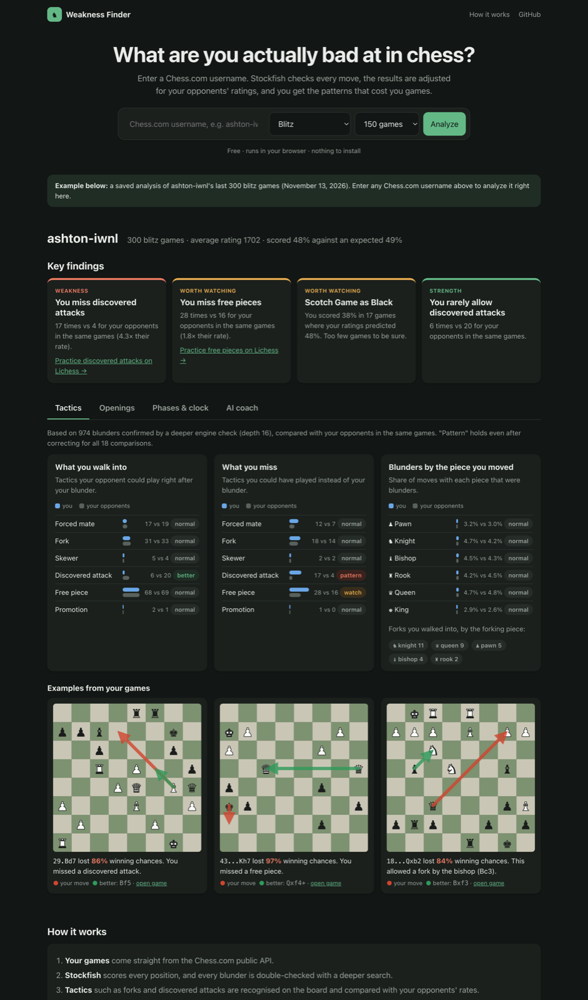

# Chess Check

Type in a Chess.com username and find out what that player is actually bad at.

**[Try the live demo](https://ashtonaliu.github.io/chess-check/)**. It runs entirely in your browser, so there is nothing to install and no account needed.



## What it does

1. Downloads your recent games from Chess.com.
2. Runs the Stockfish chess engine on every move to find your mistakes, then double-checks each mistake with a deeper search.
3. Recognizes the tactic behind each blunder (a fork you walked into, a discovered attack you missed, a free piece you left) and which piece you moved.
4. Checks each opening against what your rating predicts, so a bad result against stronger players does not count against you.
5. Estimates whether you blunder more than similar players would in the same positions, and whether time pressure is the cause.
6. Has an AI coach write a short report, then checks every number and move in it against the real data before showing it.
7. Gives you a short recap after each game you finish, in a Chrome extension next to Chess.com or on the website.

Everything is compared with your opponents in the same games. A typical result, from my own games: *"You miss discovered attacks: 17 times in positions where you blundered, against 4 for your opponents."*

## Try it

1. Open the [demo](https://ashtonaliu.github.io/chess-check/). It starts with an analysis of my own 300 blitz games.
2. Enter any Chess.com username and press Analyze. 150 games take about 15 to 40 seconds.
3. Press **Follow my games** to get a recap after every game you finish: the result and how surprising it was, the turning point on a board, your record in that opening, whether the mistake fits one of your patterns, and a note on your opponent.
4. For the AI coaching report, paste your own [Anthropic API key](https://console.anthropic.com/settings/keys). The key only goes from your browser to Anthropic, and a report costs under one cent.

## How it works

1. **Games:** pulled from the Chess.com public API.
2. **Engine:** Stockfish scores every position. I measure mistakes as lost winning chances, so dropping from +9 to +6 barely counts but +1 to -2 does. Every move flagged as a blunder is checked again with a deeper search, which throws out about 13% of them.
3. **Tactics:** for each confirmed blunder, the code looks at the board to name the tactic in the opponent's best reply and in the move you should have played, then compares your counts with your opponents'.
4. **Openings:** each game's result is compared with the result your rating predicted. A statistical model then pulls small samples toward your average, so 4 unlucky games do not get called a weakness.
5. **Blunder model:** a machine learning model learns from your opponents' moves how often a player at your level blunders in a given position and clock situation. Comparing your real blunders with that prediction shows whether you blunder more than expected.
6. **AI coach:** Claude gets the computed facts plus tools to query your games, search them, and run Stockfish. A checker verifies every number, move and link in its report. If something is not supported, the coach gets one chance to fix it.

## Post-game recaps

**Chrome extension.** The extension puts a small cube on Chess.com pages that you can drag anywhere. There is nothing to set up: open one of your finished games and the cube turns green; click it to see the recap. While you are playing, clicking it only says the recap will appear when the game ends. To install it before it is in the Chrome Web Store:

1. Run `scripts/build_extension.sh` (or download the zip from the releases page and unzip it).
2. Open `chrome://extensions`, turn on **Developer mode**, click **Load unpacked** and choose the `extension` folder.
3. Reload your Chess.com tab and open a finished game. The first recap analyzes your last 150 games in that time control, which takes a minute or two.

The cube knows who you are from the Chess.com account you are signed in to, and it gets both players from the game itself. If you are signed out, it asks once which of the two players you are. It reads nothing else from the page, and it runs no analysis until Chess.com lists the game as finished, so Stockfish never runs during a game. Clicking the toolbar icon hides or shows the cube.

**On the website,** press **Follow my games** and keep the tab open; a recap appears after each game you finish.

Recaps only cover finished games. Chess.com's fair-play rules forbid outside help during a game, and in live chess the clock starts the moment you are paired, so anything shown "before" a game is really shown during it. That is why the app shows nothing about your opponent until the game is over, and why the win probability appears afterwards as an upset meter ("Before the game you had a 46% expected score") rather than as a prediction. Finished games reach the Chess.com public API within about a minute, and the page checks every 45 seconds.

## Results

**Blunder model.** Predicting which moves will be blunders, tested on 14,217 moves the models never saw (AUC: 0.5 is guessing, 1.0 is perfect).

| Model | AUC |
|---|---:|
| Guessing | 0.50 |
| Logistic regression | 0.82 |
| Gradient boosting | 0.84 |
| Neural network (PyTorch) | 0.85 |

The biggest predictor of a blunder is how little time is left on the clock. The site uses logistic regression because its predictions were the most accurate in the time-pressure range, even though its overall AUC is a little lower.

**Tactic detector.** I tested the detector on 20,000 Lichess puzzles, using Lichess's own theme tags as the answers. The app only names a tactic when this test showed it was usually right.

| Tactic | Precision | Recall |
|---|---:|---:|
| Fork | 0.83 | 0.70 |
| Skewer | 0.68 | 0.51 |
| Discovered attack | 0.63 | 0.55 |
| Free piece | 0.58 | 1.00 |

Pins and back-rank mates scored too low (precision 0.49 and 0.27), so the app leaves them out. Forced mates come from the engine score instead of the board.

**AI coach accuracy.** The share of numbers and moves in the coach's reports that could not be backed up by the data, across 5 players.

| Setup | Unsupported claims |
|---|---:|
| Claude reading raw game files | 14% |
| Claude with computed facts and tools | 2% |
| Same, plus the checker and one fix | 0% |

When I checked a raw report by hand, most of its claims were true but impossible to verify, and one win-loss record was simply wrong. Giving the coach computed facts makes every claim checkable.

**Which model writes the report.** I ran the same coach with three Claude models on the same 5 players.

| Model | Unsupported claims, first draft | Key findings cited | Cost per report |
|---|---:|---:|---:|
| Opus 5.5 | 12% | 84% | $0.15 |
| Sonnet 5.5 | 12% | 88% | $0.06 |
| **Haiku 5.5** | **4%** | **84%** | **$0.005** |

The smallest model was the most accurate and about 34 times cheaper than Opus, so the coach uses Haiku. Sonnet kept putting citations in the wrong sentence even after the checker told it how to fix them. I also found that Haiku listed small-sample openings ahead of a stronger finding, so I added a rule to order findings by strength of evidence; after that, every report led with the strongest finding.

**Game search.** The coach can search your games by meaning, for example "games where I threw away a winning position". I tested 13 questions with known right answers (precision@5: the share of the top 5 results that are correct).

| Search method | Precision@5 |
|---|---:|
| Random | 0.17 |
| Keyword matching | 0.41 |
| AI embeddings | 0.35 |
| Both combined | 0.45 |

Embeddings understand rewording ("got flagged" finds games lost on time) but confuse who did what ("my king got mated" also finds games where I mated someone). Keywords handle that case, so the coach uses both.

**Does a player's history predict the result?** I wanted to know whether a pre-game "odds" number could beat plain ratings, so I tested it on 1,780 blitz games from 30 players, using only games that ended before each one. History meant recent form, results with each color, each player's main opening, win streaks and how many games they had played in the last hour. I scored both models on players they had not seen (Brier score: 0.25 is a coin flip, lower is better).

| Model | Brier score |
|---|---:|
| Elo formula from the two ratings | 0.239 |
| Ratings, fitted | 0.239 |
| Ratings plus history | 0.241 |

With this sample, history did not measurably improve on ratings. The small loss (0.0006 to 0.0035 worse, 90% interval) comes from fitting 14 extra features to 1,780 games. That is not the same as showing history is useless. Chess.com pairs you with someone of about your rating, so most games start close to a coin flip, and an edge of 3 percentage points per game would only change the Brier score by about 0.001, three times smaller than this test could see. The app does not show pre-game odds anyway because of the fair-play rules below.

## What I learned

- **Small samples lie.** My Scotch Game as Black looked terrible at 21% over 12 games. The model only marked it "worth watching" because with 34 openings, one bad result is expected by luck. Sixteen games later it was 38%, which is normal.
- **Test against real data early.** Running on my own games exposed a statistics bug that squashed real effects to almost zero, and a blunder baseline that compared me with myself.
- **A detector that finds everything is useless.** My first tactic detector caught almost every fork but also flagged many moves that were not forks (precision 0.42). Adding the rule that the forking piece must not simply be capturable raised it to 0.83.
- **Check the checker.** My claim checker had three bugs of its own. One rejected correct game links, so the coach deleted good information to make it happy.
- **Measure before trusting the hype.** AI embeddings alone did worse than plain keyword search. Combining them did best.
- **The biggest model is not always the best one.** Haiku beat Opus on accuracy at a thirtieth of the price. Measuring it took an hour; guessing would have cost 30 times more per report.
- **Check where the numbers come from.** My first run of the odds test said a fitted model beat the Elo formula by a wide margin. The reason was that Chess.com's archive stores each player's rating after the game, so the winner's rating already included the points they won. Using each player's rating from their previous game removed the gap.
- **Two versions keep each other honest.** I wrote the analysis in Python and again in TypeScript for the browser. Testing that both give the same answers caught a rounding difference and a solver that stopped too early.

## Tech used

| Area | Tools |
|---|---|
| Languages | Python, TypeScript |
| Machine learning | scikit-learn, PyTorch, a hierarchical Bayesian model, sentence embeddings |
| AI | Claude API, tool use, MCP, retrieval (embeddings plus BM25), evals |
| Data | DuckDB (also in the browser), MySQL, pandas |
| Chess | Stockfish (native and WebAssembly), python-chess, chess.js |
| App | FastAPI, Docker, GitHub Pages, GitHub Actions |

## Run it locally

You need Python 3.11+, Node 18+, and Stockfish (`brew install stockfish`).

```bash
python -m venv .venv && .venv/bin/pip install -r requirements-dev.txt
(cd web && npm install && npm run build)
.venv/bin/uvicorn server:app --port 8765
```

Then open http://localhost:8765. For the AI coach, either log in to [Claude Code](https://claude.com/claude-code) or put `ANTHROPIC_API_KEY=...` in a `.env` file (see `.env.example`).

To run everything with MySQL instead, set the passwords in `.env` and run `docker compose up --build`.

Tests: `.venv/bin/python -m pytest -q` (Python) and `cd web && npm test` (TypeScript).

## More detail

[docs/methods.md](docs/methods.md) has the full write-up: the statistical model, the evals and how they were scored, the MySQL setup, the three ways the coach runs, deployment, and every design decision with its reasoning.

## License note

The browser demo serves [Stockfish.js](https://github.com/nmrugg/stockfish.js) (GPL-3.0) unmodified as a separate file.
