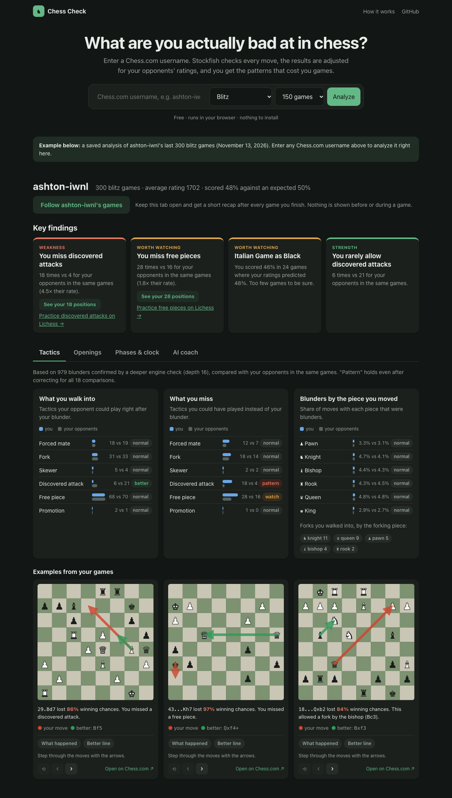

# Chess Check

Type in a Chess.com username and find out what that player is actually bad at.

**[Try the live demo](https://ashtonaliu.github.io/chess-check/)**. It runs entirely in your browser, so there is nothing to install and no account needed.



## What it does

1. Downloads your recent games from Chess.com.
2. Runs the Stockfish chess engine on every move to find your mistakes, then double-checks each mistake with a deeper search.
3. Names the tactic behind each blunder (a fork you walked into, a discovered attack you missed, a free piece you left) and which piece you moved.
4. Checks each opening against what your rating predicted, so a bad result against stronger players does not count against you.
5. Estimates whether you blunder more than similar players would in the same positions, and whether time pressure is the cause.
6. Has an AI coach write a short report, then checks every number and move in it against the real data before showing it.
7. Shows a short recap after each game you finish, in a Chrome extension on Chess.com or on the website.

Everything is compared with your opponents in the same games. A typical result, from my own games: *"You miss discovered attacks: 17 times in positions where you blundered, against 4 for your opponents."*

## Try it

1. Open the [demo](https://ashtonaliu.github.io/chess-check/). It starts with an analysis of my own 300 blitz games.
2. Enter any Chess.com username and press Analyze. 150 games take about 30 seconds.
3. For the AI coaching report, paste your own [Anthropic API key](https://console.anthropic.com/settings/keys). The key only goes from your browser to Anthropic, and a report costs under one cent.

**The Chrome extension** puts a small cube on Chess.com that you can drag anywhere. Open a finished game and the cube turns green; click it for the recap. It knows who you are from your signed-in account and needs no setup. Chess.com's fair-play rules forbid outside help during a game, so the extension computes and shows nothing about a game until it is over, and the recap appears about 2 seconds after it ends. To install it before it is in the Chrome Web Store, run `scripts/build_extension.sh`, open `chrome://extensions`, turn on Developer mode, click Load unpacked and choose the `extension` folder.

## Results

**Blunder model.** Predicting which moves will be blunders, tested on 14,217 moves the models never saw (AUC: 0.5 is guessing, 1.0 is perfect).

| Model | AUC |
|---|---:|
| Logistic regression | 0.82 |
| Gradient boosting | 0.84 |
| Neural network (PyTorch) | 0.85 |

The biggest predictor of a blunder is how little time is left on the clock. The site uses logistic regression because its predictions were the most accurate in the time-pressure range.

**Tactic detector.** I tested it on 20,000 Lichess puzzles, using Lichess's own theme tags as the answers.

| Tactic | Precision | Recall |
|---|---:|---:|
| Fork | 0.83 | 0.70 |
| Skewer | 0.68 | 0.51 |
| Discovered attack | 0.63 | 0.55 |
| Free piece | 0.58 | 1.00 |

Pins and back-rank mates scored too low (precision 0.49 and 0.27), so the app leaves them out.

**AI coach accuracy.** The share of numbers and moves in the coach's reports that the data could not back up, across 5 players.

| Setup | Unsupported claims |
|---|---:|
| Claude reading raw game files | 14% |
| Claude with computed facts and tools | 2% |
| Same, plus the checker and one fix | 0% |

Giving the coach computed facts makes every claim checkable, and the checker catches the rest.

**Which model writes the report.** The same coach, three Claude models, the same 5 players.

| Model | Unsupported claims, first draft | Cost per report |
|---|---:|---:|
| Opus 5.5 | 12% | $0.15 |
| Sonnet 5.5 | 12% | $0.06 |
| **Haiku 5.5** | **4%** | **$0.005** |

The smallest model was the most accurate and about 30 times cheaper than Opus, so the coach uses Haiku.

**Game search.** The coach can search your games by meaning, such as "games where I threw away a winning position". On 13 questions with known answers (share of the top 5 results that are correct):

| Search method | Precision@5 |
|---|---:|
| Keyword matching | 0.41 |
| AI embeddings | 0.35 |
| Both combined | 0.45 |

Embeddings understand rewording but confuse who did what, and keywords cover that case, so the coach uses both.

**Can anything beat the rating at predicting a game?** I tested this on the blitz histories of 12,233 players, fitting on 4.4 million player-games from before November 1 and testing on 1.5 million from after November 7 (Brier score: lower is better, 0.25 is a coin flip).

| Model | Brier score |
|---|---:|
| Elo formula | 0.23765 |
| Elo recalibrated, plus color | 0.23683 |
| ...plus the player's recent history | 0.23667 |

Most of the gain comes from fixing the formula. In matched games a rating gap matters about half as much as Elo assumes, and White scores 51.7% while Elo ignores color. History adds a little: players far below their recent average beat their rating by 2.4 points, and players score worse right after a loss. Openings, clock habits, session length, playstyles learned from 6.5 million games, and Stockfish profiles of both players' last 50 games added nothing measurable. The extension's upset meter and the report's opening tables now use the recalibrated formula.

**Engine dataset.** To make later questions cheap, I analyzed 664,898 games (49.1 million positions) once with Stockfish 19, keeping the two best moves, win/draw/loss chances and clock time for every position. It took 33 hours on my laptop, and profiles for all 171,126 players in it now take 12 seconds to compute.

## How it works

The analysis runs twice from the same design: in Python (`chesscheck/`) as the reference, and in TypeScript in the browser for the demo and the extension, with tests checking that both give the same answers. [docs/methods.md](docs/methods.md) has the full write-up: the statistical model, every eval and how it was scored, the extension's design, the odds studies with their leak checks, and the engine dataset.

## What I learned

- **Small samples lie.** My Scotch Game as Black looked terrible at 21% over 12 games. The model only marked it "worth watching" because with 34 openings, one bad result is expected by luck. Sixteen games later it was 38%, which is normal.
- **Check where the numbers come from.** My first odds test said a fitted model beat the Elo formula by a wide margin. Chess.com stores each player's rating after the game, so the winner's rating already included the points they won. Using the rating from their previous game removed the gap.
- **A result that looks too good probably is.** A later run said gradient boosting beat ratings clearly, but no single feature helped on its own. Two features measured time from when the game ended, so they included how long the game lasted, which gives away how it ended. Measured from the previous game instead, the gain disappeared.
- **"No effect" depends on the sample size.** Fifteen thousand games said history does not beat ratings. Six million said it does, by about a point per game. Both were true for what each could see.
- **The biggest model is not always the best one.** Haiku beat Opus on accuracy at a thirtieth of the price, and measuring it took an hour.
- **Check the checker.** My claim checker had three bugs of its own, and one made the coach delete correct information to satisfy it.
- **Two versions keep each other honest.** Testing that the Python and TypeScript versions agree caught a rounding difference and a solver that stopped too early.

## Tech used

| Area | Tools |
|---|---|
| Languages | Python, TypeScript |
| Machine learning | scikit-learn, PyTorch, a hierarchical Bayesian model, calibration, sentence embeddings |
| AI | Claude API, tool use, MCP, retrieval (embeddings plus BM25), evals |
| Data | DuckDB (also in the browser), Parquet, MySQL, pandas |
| Chess | Stockfish (native and WebAssembly), python-chess, chess.js |
| App | Chrome extension (Manifest V3), FastAPI, Docker, GitHub Pages, GitHub Actions CI |

## Run it locally

You need Python 3.11+, Node 18+, and Stockfish (`brew install stockfish`).

```bash
python -m venv .venv && .venv/bin/pip install -r requirements-dev.txt
(cd web && npm install && npm run build)
.venv/bin/uvicorn server:app --port 8765
```

Then open http://localhost:8765. For the AI coach, either log in to [Claude Code](https://claude.com/claude-code) or put `ANTHROPIC_API_KEY=...` in a `.env` file (see `.env.example`). To run with MySQL instead, set the passwords in `.env` and run `docker compose up --build`.

Tests: `.venv/bin/python -m pytest -q` and `cd web && npm test`. GitHub Actions runs both, plus the site and extension builds, on every pull request.

## License note

The browser demo serves [Stockfish.js](https://github.com/nmrugg/stockfish.js) (GPL-3.0) unmodified as a separate file.
